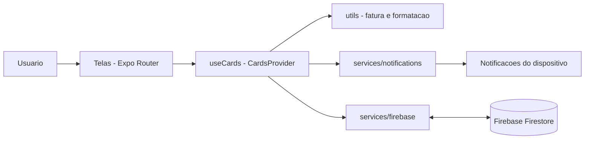
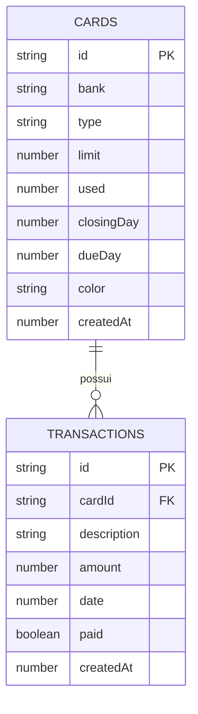

# PocketCard

Controle de cartões de crédito, faturas e limites na palma da mão.

---

## 1. Descrição do projeto

### Objetivo

O PocketCard é um aplicativo mobile para organizar o uso de cartões de crédito. Ele permite cadastrar cartões, lançar despesas, acompanhar o limite restante, visualizar a fatura aberta de cada cartão e receber avisos de vencimento e de limite esgotado.

### Problema que resolve

Quem possui mais de um cartão costuma perder o controle de quanto já gastou, de quanto ainda pode gastar e de quando cada fatura fecha e vence. O PocketCard centraliza essas informações em um único lugar, calculando automaticamente o período da fatura de cada cartão a partir dos dias de fechamento e vencimento.

### Público-alvo

Pessoas que usam um ou mais cartões de crédito (físicos ou virtuais) e querem acompanhar gastos, limite e vencimentos sem depender de planilhas.

### Principais funcionalidades

- Cadastro de cartões com banco, tipo, limite, dia de fechamento, dia de vencimento e cor.
- Lançamento de despesas vinculadas a um cartão, com descontos automáticos no limite.
- Cálculo automático da fatura aberta, do período de compras e da data de vencimento.
- Pagamento de fatura, que marca as despesas como pagas e libera o limite.
- Notificações locais de limite esgotado e de vencimento de fatura.
- Sincronização em tempo real com o Firebase Firestore.

---

## 2. Funcionalidades

### Cadastro de informações

- Cadastro de cartão: banco, tipo (físico ou virtual), limite total, dia de fechamento (1 a 31), dia de vencimento (1 a 31) e cor do cartão.
- Cadastro de despesa: cartão, descrição, valor e data da compra (não permite data futura).
- Validações de formulário: banco obrigatório, limite e valor maiores que zero, dias entre 1 e 31.
- Aviso na tela de despesa quando a compra estoura o limite restante do cartão.

### Edição de registros

- O limite utilizado do cartão é atualizado automaticamente a cada despesa lançada, excluída ou paga.
- Ao pagar uma fatura, as despesas do período são marcadas como pagas.
- Não há edição direta dos campos de um cartão ou de uma despesa já salvos (ver seção de melhorias futuras).

### Exclusão de registros

- Exclusão de despesa: o valor volta para o limite do cartão (se a despesa ainda não estava paga).
- Exclusão de cartão: remove também todas as despesas associadas a ele.
- Todas as exclusões pedem confirmação antes de serem executadas.

### Consultas e pesquisas

- Tela de cartões com o limite disponível somado de todos os cartões.
- Cartão estilo "plástico" com fatura atual, barra de uso do limite, limite restante, limite total, dia de fechamento e data de vencimento.
- Detalhe do cartão com a lista de compras da fatura aberta e o período correspondente.
- Tela de gastos com o histórico de todas as despesas, ordenado da mais recente para a mais antiga.

### Outras funcionalidades

- Pagamento de fatura com liberação do limite.
- Notificação imediata quando uma compra esgota o limite do cartão.
- Notificação agendada para as 9h, um dia antes do vencimento, para cada cartão com fatura em aberto.
- Indicação de uso offline, quando os dados vêm do cache local do Firestore.
- Animações de entrada nas listas.

---

## 3. Tecnologias utilizadas

| Categoria | Tecnologia | Versão |
|---|---|---|
| Linguagem | JavaScript (ES2020+) | - |
| Framework mobile | React Native | 0.88.1 |
| Plataforma | Expo | ~58.0.23 |
| Biblioteca de UI | React | 19.3.0 |
| Navegação | Expo Router | ~58.0.30 |
| Banco de dados | Firebase Firestore (NoSQL) | firebase ^13.2.0 |
| Notificações | expo-notifications | ~58.1.8 |
| Seletor de data | @react-native-community/datetimepicker | 9.2.1 |
| Ícones | @expo/vector-icons | ^15.0.2 |
| Web (opcional) | react-native-web | ^0.21.4 |
| Gerenciador de pacotes | npm | - |

Ferramentas de apoio: Expo CLI (`npx expo`), Expo Go ou development build, EAS (build e atualizações), Git e GitHub.

---

## 4. Arquitetura do projeto

O PocketCard é um aplicativo **sem back-end próprio**. O front-end em React Native se comunica diretamente com o Firebase Firestore por meio do SDK oficial.

### Organização

- **Telas (`app/`)**: rotas baseadas em arquivos, gerenciadas pelo Expo Router.
- **Estado global (`store/`)**: `CardsProvider`, um Context API que mantém cartões e despesas em memória, escuta o Firestore em tempo real e expõe as operações (adicionar, excluir, pagar).
- **Serviços (`services/`)**: inicialização do Firebase e configuração das notificações.
- **Regras de negócio (`utils/`)**: cálculo de ciclo de fatura, vencimento e formatação.
- **Componentes (`components/`)**: elementos visuais reutilizáveis.

### Fluxo básico da aplicação

1. Ao abrir o app, o `RootLayout` solicita permissão de notificações e envolve toda a aplicação no `CardsProvider`.
2. O `CardsProvider` assina as coleções `cards` e `transactions` do Firestore com `onSnapshot`. Qualquer mudança no banco atualiza as telas em tempo real.
3. As telas leem os dados pelo hook `useCards()` e calculam a fatura de cada cartão com `getInvoice()`.
4. Ao salvar uma despesa, o app grava a transação e incrementa o campo `used` do cartão em um único `writeBatch`, garantindo consistência.
5. Sempre que cartões ou despesas mudam, os lembretes de vencimento são reagendados.

### Diagrama



---

## 5. Pré-requisitos

- **Node.js** em versão LTS recente (compatível com o Expo SDK 58).
- **npm** (instalado junto com o Node.js).
- **Git**.
- **Expo Go** instalado no celular (Android ou iOS), ou um emulador/simulador:
  - Android Studio (emulador Android).
  - Xcode (simulador iOS, somente macOS).
- **Projeto Firebase** com o Firestore habilitado (ver seção 7).

Dependências do projeto são instaladas com `npm install`, a partir do `package.json`.

> Observação: o `expo-notifications` exige um development build para funcionar plenamente em algumas versões do Expo Go. Se as notificações não aparecerem, gere um build de desenvolvimento (ver seção 8).

---

## 6. Como clonar o projeto

```bash
git clone https://github.com/<usuario>/<repositorio>.git
cd <repositorio>
```

Substitua `<usuario>` e `<repositorio>` pela URL real do repositório do grupo.

---

## 7. Como configurar o ambiente

### 7.1 Instalar as dependências

```bash
npm install
```

Para adicionar novas bibliotecas, use sempre o comando abaixo, que escolhe a versão compatível com o SDK do Expo:

```bash
npx expo install <pacote>
```

### 7.2 Configurar o banco de dados (Firebase Firestore)

1. Acesse o [Console do Firebase](https://console.firebase.google.com) e crie um projeto.
2. Em **Build > Firestore Database**, crie um banco de dados.
3. Em **Configurações do projeto > Seus aplicativos**, registre um app **Web** e copie as credenciais exibidas.
4. Defina as regras de segurança do Firestore. O aplicativo não possui autenticação de usuários, portanto, para ambiente de estudo, as regras precisam permitir leitura e escrita nas coleções `cards` e `transactions`. Para uso real, implemente autenticação e restrinja o acesso.

As coleções são criadas automaticamente no primeiro cadastro, pois o Firestore é NoSQL e não exige criação prévia de tabelas.

### 7.3 Configurar as variáveis de ambiente

Copie o arquivo de exemplo e preencha com as credenciais do seu projeto Firebase:

```bash
cp .env.example .env
```

Conteúdo esperado do `.env`:

```env
EXPO_PUBLIC_FIREBASE_API_KEY=
EXPO_PUBLIC_FIREBASE_AUTH_DOMAIN=
EXPO_PUBLIC_FIREBASE_PROJECT_ID=
EXPO_PUBLIC_FIREBASE_STORAGE_BUCKET=
EXPO_PUBLIC_FIREBASE_MESSAGING_SENDER_ID=
EXPO_PUBLIC_FIREBASE_APP_ID=
```

Importante:

- Nunca publique o arquivo `.env` com credenciais reais no repositório.
- Garanta que o `.env` esteja no `.gitignore`. O `.gitignore` atual ignora apenas `.env*.local`, então adicione a linha `.env` a ele.
- Variáveis com prefixo `EXPO_PUBLIC_` ficam embutidas no aplicativo. Por isso a segurança dos dados deve ser garantida pelas regras do Firestore.

---

## 8. Como executar o projeto

### Back-end

Não há back-end próprio. O Firebase Firestore é um serviço gerenciado na nuvem e não precisa ser iniciado localmente.

### Front-end

```bash
npm start            # inicia o servidor de desenvolvimento do Expo
npm run android      # abre no emulador/dispositivo Android
npm run ios          # abre no simulador iOS (macOS)
npm run web          # abre no navegador
```

Após `npm start`, escaneie o QR Code com o Expo Go (Android) ou com a câmera (iOS).

### Development build (opcional)

Necessário caso uma biblioteca com código nativo não esteja disponível no Expo Go:

```bash
npx expo run:android
npx expo run:ios
```

ou, na nuvem, com EAS:

```bash
npx eas-cli@latest build --profile development
```

### Banco de dados

Executado e hospedado pelo Firebase. Basta que o `.env` esteja configurado corretamente.

### Portas e URL de acesso

- Servidor de desenvolvimento (Metro): porta `8081` (padrão do Expo).
- Versão web: `http://localhost:8081`.
- Esquema de links do app: `pocketcard://`.

### Outros comandos úteis

```bash
npx expo lint               # análise estática
npx expo-doctor             # diagnóstico de dependências e configuração
npx expo install --fix      # corrige versões incompatíveis
```

---

## 9. Estrutura de pastas

```text
PocketCard/
├── app/                        # Telas (rotas do Expo Router)
│   ├── _layout.js              # Layout raiz: provider, stack e permissão de notificações
│   ├── (tabs)/                 # Navegação por abas
│   │   ├── _layout.js          # Configuração das abas (Cartões e Gastos)
│   │   ├── index.js            # Tela de cartões e limite disponível
│   │   └── expenses.js         # Histórico de despesas
│   ├── card/
│   │   └── [id].js             # Detalhe do cartão, fatura e pagamento
│   ├── new-card.js             # Formulário de novo cartão (modal)
│   └── new-expense.js          # Formulário de nova despesa (modal)
├── components/                 # Componentes reutilizáveis
│   ├── CardItem.js             # Cartão visual com fatura e limite
│   ├── FadeIn.js               # Animação de entrada
│   └── ui.js                   # Field, Chip e PrimaryButton
├── services/                   # Integrações externas
│   ├── firebase.js             # Inicialização do Firebase e do Firestore
│   └── notifications.js        # Notificações de limite e de vencimento
├── store/
│   └── cards-context.js        # Estado global e operações no Firestore
├── utils/                      # Regras de negócio e utilitários
│   ├── invoice.js              # Ciclo da fatura e data de vencimento
│   ├── format.js               # Formatação de moeda e data
│   └── theme.js                # Cores e paleta dos cartões
├── assets/                     # Ícones, favicon e splash
├── app.json                    # Configuração do Expo
├── package.json                # Dependências e scripts
├── .env.example                # Modelo das variáveis de ambiente
├── AGENTS.md / CLAUDE.md       # Instruções para assistentes de código
└── LICENSE                     # Licença MIT
```

Onde ficam os elementos principais:

- **Telas (equivalentes a controllers de rota)**: `app/`
- **Componentes**: `components/`
- **Serviços**: `services/`
- **Estado e acesso a dados**: `store/`
- **Regras de negócio**: `utils/`

---

## 10. Banco de dados

O projeto usa o **Firebase Firestore**, um banco NoSQL orientado a documentos. Por isso, em vez de tabelas, há **coleções**, e o relacionamento é feito por referência (`cardId`).

### Modelo entidade-relacionamento (DER)



### Coleções e responsabilidades

**`cards`** - cartões cadastrados.

| Campo | Tipo | Descrição |
|---|---|---|
| `bank` | string | Nome do banco ou emissor |
| `type` | string | `fisico` ou `virtual` |
| `limit` | number | Limite total do cartão |
| `used` | number | Limite já utilizado (atualizado por incremento) |
| `closingDay` | number | Dia de fechamento da fatura (1 a 31) |
| `dueDay` | number | Dia de vencimento da fatura (1 a 31) |
| `color` | string | Cor do cartão em hexadecimal |
| `createdAt` | number | Timestamp de criação em milissegundos |

**`transactions`** - despesas lançadas.

| Campo | Tipo | Descrição |
|---|---|---|
| `cardId` | string | Id do cartão ao qual a despesa pertence |
| `description` | string | Descrição da compra |
| `amount` | number | Valor da compra |
| `date` | number | Data da compra em milissegundos |
| `paid` | boolean | Indica se a despesa já foi paga |
| `createdAt` | number | Timestamp de criação em milissegundos |

### Relacionamentos

- Um cartão possui várias despesas (1:N), ligadas pelo campo `cardId`.
- Ao excluir um cartão, o aplicativo apaga também as despesas relacionadas (exclusão em cascata feita na aplicação).
- O campo `used` do cartão é mantido em sincronia com as despesas por meio de `writeBatch` e `increment`.

### Scripts de criação e população

O Firestore não exige scripts de criação de tabelas. As coleções surgem no primeiro uso. Para popular com dados de teste, cadastre pelo aplicativo ou crie os documentos manualmente no Console do Firebase, seguindo os campos acima. Exemplo de documento em `cards`:

```json
{
  "bank": "Nubank",
  "type": "fisico",
  "limit": 3000,
  "used": 0,
  "closingDay": 25,
  "dueDay": 5,
  "color": "#7A3E9D",
  "createdAt": 1731283200000
}
```

---

## 11. Desenvolvedores

Preencha a tabela com os dados reais do grupo.

| Nome | GitHub | Responsabilidade |
|---|---|---|
| Nome do integrante 1 | [@usuario1](https://github.com/usuario1) | Ex.: telas e navegação |
| Nome do integrante 2 | [@usuario2](https://github.com/usuario2) | Ex.: integração com Firebase |
| Nome do integrante 3 | [@usuario3](https://github.com/usuario3) | Ex.: regras de fatura e notificações |
| Nome do integrante 4 | [@usuario4](https://github.com/usuario4) | Ex.: documentação e testes |

---

## 12. Padrões de desenvolvimento

Sugestão de padrões para o grupo seguir. Ajuste conforme o combinado com a equipe.

### Convenção de nomes

- **Componentes React**: `PascalCase` (`CardItem.js`).
- **Funções e variáveis**: `camelCase` (`getInvoice`, `closingDay`).
- **Constantes de módulo**: `camelCase` ou `UPPER_SNAKE_CASE` para valores fixos.
- **Arquivos de utilidade e serviços**: `kebab-case` ou `camelCase` (`cards-context.js`, `invoice.js`).
- **Rotas**: nomes de arquivo em minúsculas, com `[param]` para rotas dinâmicas (`card/[id].js`).
- **Campos do Firestore**: `camelCase`.
- **Idioma**: interface em português; código em inglês sempre que possível.

### Padrão de branches

- `main`: versão estável.
- `develop`: integração das funcionalidades.
- `feature/<nome-da-funcionalidade>`: novas funcionalidades (ex.: `feature/editar-cartao`).
- `fix/<descricao>`: correções de bugs (ex.: `fix/calculo-vencimento`).
- `docs/<descricao>`: documentação.

Fluxo: criar a branch a partir de `develop`, abrir Pull Request e exigir revisão de pelo menos um integrante antes do merge.

### Padrão de commits

Seguir o padrão **Conventional Commits**:

```text
<tipo>: <descrição curta no imperativo>
```

Tipos: `feat`, `fix`, `docs`, `style`, `refactor`, `test`, `chore`.

Exemplos:

```text
feat: adiciona pagamento de fatura
fix: corrige data de vencimento em fevereiro
docs: atualiza README com instruções do Firebase
```

### Organização das funcionalidades

- Cada tela fica em `app/`, sem lógica de negócio pesada.
- Regras de negócio e cálculos ficam em `utils/`.
- Acesso ao Firebase e a APIs do dispositivo ficam em `services/` e `store/`.
- Componentes visuais compartilhados ficam em `components/`.
- Cada funcionalidade nova deve ser desenvolvida em sua própria branch e integrada via Pull Request.

---

## 13. Melhorias futuras

- Edição de cartões e despesas já cadastrados.
- Autenticação de usuários e regras de segurança por usuário.
- Filtros e busca na lista de gastos.
- Parcelamento de compras.
- Relatórios e gráficos por categoria.

---

## 14. Licença

Distribuído sob a licença MIT. Consulte o arquivo [LICENSE](./LICENSE) para mais detalhes.
